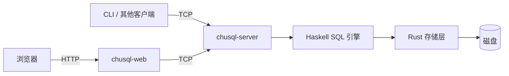

# 架构与组件

[← 返回 README](../README.md)

**本页导航：** [组件与访问路径](#组件与访问路径) · [数据目录](#数据目录) · [会话与并发](#会话与并发) · [SQL 查询处理](#sql-查询处理) · [快照事务](#快照事务) · [WAL 与崩溃恢复](#wal-与崩溃恢复) · [页面与空间回收](#页面与空间回收) · [身份、授权与系统目录](#身份授权与系统目录) · [权限变更与会话失效](#权限变更与会话失效) · [扩展方向](#扩展方向)

ChuSQL 采用客户端 / 服务端架构。正常运行时，只有数据库服务直接访问数据文件；离线初始化与恢复由 bootstrap 完成。

## 组件与访问路径

| 组件 | 职责 |
| --- | --- |
| chusql-server | 登录、会话、鉴权、SQL 执行和事务 |
| chusql-web | Web 管理界面，通过 TCP 访问服务 |
| csql | 命令行客户端，通过 TCP 执行 SQL |
| chusql-core/engine | 解析、语义检查、优化及执行 |
| chusql-core/storage | catalog、页面、B+ 树、缓存、WAL 与持久化 |
| csql-bootstrap | 安装引导及离线系统目录修复、恢复、重置 |

查询 AST 的 `Select` 使用 `selectItems :: [(String, Expr)]` 保存输出名称与投影表达式，`selectHaving` 保存分组条件；`OrderKey` 明确区分名称、输出序号和表达式。普通列使用 `Col`，别名、计算和聚合使用相同结构。便捷函数 `makeSelect` 接受列名列表并构造这些投影项。

服务默认监听 127.0.0.1:7777，Web 默认监听 127.0.0.1:7778。配置位置和平台数据目录见 [config.md](config.md)。

## 数据目录

`[storage] data_dir` 保存持久化数据，`log_files` 单独指定诊断日志目录。

| 位置 | 内容 |
| --- | --- |
| system/ | 身份、凭据、角色、授权和预定义类型目录 |
| databases/<数据库名>/ | 业务数据库的 catalog、数据与索引 |
| WAL 与检查点文件 | 已提交写入的恢复记录及刷盘进度 |

安装只初始化系统数据库，业务数据库由用户创建。表存在性以 catalog 为准，不能仅凭数据文件判断。

## 会话与并发

- 每条 TCP 连接拥有独立会话，当前数据库和事务互不影响。
- 读请求可并行，写请求由存储层协调。
- Web 与 CLI 共享服务端的权限和执行规则，不直接读写数据目录。
- Web 登录会话分别持有普通 API / SQL 连接与表格编辑连接，编辑事务按页面标识固定数据库。表格读取携带编辑标识时使用该事务快照；普通查询不进入编辑事务。
- 同一 Web Cookie 的请求串行执行。编辑提交以固定保存点重放本地编辑集，失败整体回退；成功回执按提交标识去重。SQL 控制台事务另按页面与标签标识限制连接访问。

## SQL 查询处理

查询依次经过解析、基于 schema 的语义检查、优化和执行。库名、表名、列名及别名在语义层解析；存储层使用精确的表名键。

绑定查询保存依赖对象编号、schema 版本、列定义和传递 DOMAIN 依赖。执行前复查，真实存储的每次读取还在相关库读锁内验证全部依赖；结构改变或对象替换明确报错。守卫不提供整条多请求查询的数据快照；旧目录的未知身份/版本保留兼容校验，旧存储未确认守卫则拒绝执行。

查询由 `Runtime.Query.bindQuery` 统一准备并绑定，输出按位置校验，保留重复列名。优化完成后将表达式、排序及分组键绑定到输入布局；物理列顺序不同会在存储边界整理，缺列或位置不符明确报错。`ORDER BY` 输出序号保留到计划生成，选择对应投影表达式或 DISTINCT 输出槽位，不通过别名再次查找；非排序投影仍在 LIMIT 后求值。

聚合计划合并投影、HAVING 和排序表达式中的当前层聚合，重复调用只计算一次，内部列使用 SQL 标识符无法声明的名称。HAVING 强制形成分组（无键时为整体组），过滤位于 Aggregate 之后、去重与排序截断之前。表达式排序先计算隐藏排序键并保留投影所需列，再排序、截断和投影；DISTINCT 排序映射到已有输出槽位。HAVING 和排序子查询同样参与结构依赖守卫与 SELECT 权限检查。

相关子查询按最近到最远的独立列作用域查找，最近层歧义不向外回退；二段限定引用只在最近声明该来源的层解析，裸列可继续向外查找。`BoundSubquery` 保存父布局中的取值表达式，缓存按槽位和值区分；重绑定保留局部和外层身份，原位置失效时只允许唯一同名列重定位。执行期外层行仍扁平化，尚无独立作用域或来源编号，结构改写须在绑定前完成。

写语句按目标 schema 绑定输入表达式和赋值目标。INSERT 拒绝重复目标列，按输入顺序求值，再按 schema 顺序补默认值、NULL 和自增值；UPDATE 的重复赋值读取前一次修改结果，全部赋值后检查 CHECK，再检查最终行集的 NOT NULL、UNIQUE 和 PRIMARY KEY。唯一性检查保留整数与整值浮点的一致语义，多个 NULL 不冲突；检查通过前不发布修改。CHECK、非空和唯一性按列槽位取值，INSERT 已有行及引擎 ALTER 输入行按原 schema 整理，缺列不跳过。

INSERT、UPDATE、DELETE 和已有表的结构变更由 `Engine.bindWrite` 生成不保存数据行的 `BoundWrite`，`executeWriteM` 在执行前复查结构，允许跨数据及统计变化复用。DML 在绑定阶段固定 INSERT 输入槽位、UPDATE 目标槽位、DELETE 行布局和 CHECK / NOT NULL / UNIQUE / PRIMARY KEY 约束；复用时不重新解析或绑定这些内容，自增起点与行集约束仍取当前数据。结构变更则在执行时对变更后的 schema 绑定并检查约束。计划携带目标表、嵌套查询及传递 DOMAIN 依赖；ADD COLUMN / ALTER TYPE 还包含新声明类型的 DOMAIN。建表、建删库、DOMAIN 管理和会话命令继续走各自入口，不属于已有表写计划。

写入前先发送只读的 `validate_write` 请求，确认存储支持写守卫并校验依赖；未确认时不发送实际修改请求。实际读取在相关库共享门内复查，实际写入在目标库独占门及其他依赖库共享门内复查，跨库按库名排序取门。对象替换或结构版本变化使旧绑定失效，包括结构改变后恢复原定义。守卫保证结构校验与单次存储操作之间不发生 DDL，不提供整条写语句的数据快照或数据冲突检测。

CHECK 定义和执行共用类型、函数及列槽位绑定入口，拒绝聚合、子查询和非布尔条件。DROP COLUMN 校验保留下来的 CHECK；RENAME COLUMN 不自动改写约束文本，引用旧名称的 CHECK 会使改名被拒绝。ALTER TYPE 依据新 schema 校验 CHECK、默认值和键能力，空表也不跳过定义校验；通过定义校验后仍检查已有行，再发布结构变更。

| 能力 | 实现与边界 |
| --- | --- |
| 派生表 | 内层独立解析，必须有别名，不能引用外层列；输出列按别名暴露 |
| WITH / CTE | 解析时展开为派生表；相同执行子树在查询内物化复用，不支持递归 |
| ANY / ALL | 按 OR / AND 的三值逻辑求值；空集的 ANY 为假、ALL 为真 |
| 子查询复用 | 按查询定义及外层绑定值物化结果，跨过滤、投影、排序与 JOIN 复用 |
| 半连接 / 反连接 | 独立 IN / NOT IN 与简单等值相关 EXISTS / NOT EXISTS 转为哈希存在性匹配，只输出左行 |
| 成本估算 | 使用行数、不同值数和数值列的 16 桶等宽直方图 |
| 索引选择 | 优化器判断适用条件与成本，存储层管理实际索引 |

派生表可根据 schema 和透明算子估计行数并参与安全的连接重排；缺统计或可能报错时保守处理。输出列投影可下推，但保留所有计算项的求值，避免隐藏错误。内存存储提供实时行数和封顶去重统计。执行器用查询内状态保存首次使用时成功求出的子查询行；键包含已解析查询定义与具名外层绑定值，跨不同父布局复用，原始名称调用保守包含整个外层行。派生表按执行子树和外层行缓存，应用来源别名前复用，优化后子树不同则分别执行。标量、IN、EXISTS 和 ANY / ALL 各自处理共享行集，保留基数错误和三值逻辑。缓存在每次执行时清空，不跨会话或数据修改保留；既有表达式分组求值顺序保持，JOIN 空行对仍不触发子查询。尚无磁盘溢出或物化内存预算，也不提供整条查询的数据快照。统计信息只影响计划选择，优化不能改变查询结果语义。

`SemiJoin` 分别绑定两侧键，只暴露左侧布局；执行左侧为空时不求右侧，其他情况完整求右侧并构建键集合，按原左行顺序过滤，右侧重复键不会放大结果。独立 IN 保存原子查询身份，继续共享其他消费者的物化结果；NOT IN 跟踪右侧 NULL，NOT EXISTS 的空值键则视作不匹配。大整数与浮点混合比较超出安全哈希范围时退回既有逐值比较。重写只覆盖单独过滤谓词：IN 左键限普通列或简单字面量；相关 EXISTS 限单表、唯一外层等值引用和普通列／简单字面量投影。组合谓词、复杂相关条件、聚合、排序截断及可能报错的相关投影继续走原路径，避免改变错误时序和词法作用域。

完整 SQL 写法及限制见 [syntax.md](syntax.md)。

## 快照事务

| 阶段 | 行为 |
| --- | --- |
| BEGIN | 将当前数据库读为会话内存快照 |
| 事务内执行 | 读取快照与自身修改，看不到其他连接后续提交 |
| SAVEPOINT | 保存当前快照；回滚可退回指定保存点 |
| COMMIT | 比对基线与现值，确认无写写冲突后原子应用差分 |
| ROLLBACK | 丢弃会话快照与保存点 |

有整数 id 的表按行比对并提交差分；其他表按整表替换提交。发生冲突时返回 serialization_failure 并保留事务，由调用方回滚或重试。事务内不支持 DDL 或切换数据库。

## WAL 与崩溃恢复

1. 一组写操作与提交标记写入 WAL，每条记录带递增 LSN。
2. 数据和 catalog 刷盘后，检查点推进到已完成提交的 LSN。
3. 按检查点截断日志前缀，保留尚未确认刷盘的记录。
4. 重启时只重放检查点之后的已提交组，丢弃未提交组，并进行幂等检查。

建表、删表、建索引、删索引和数据修改均进入 WAL。LSN 跨重启续号，SystemStatus 的 last_lsn 表示检查点 LSN。

若系统目录损坏导致服务无法启动，使用离线 bootstrap。repair、recover 与 reset 的范围及操作步骤见 [bootstrap.md](bootstrap.md)。

## 页面与空间回收

- 删除行先将槽位标记为墓碑。
- 死空间达到页大小的四分之一时，随删除整理页内活行。
- 整理保留槽位编号，索引中的页号与槽号仍有效。
- compact 通常逐页整理；存在 DROP COLUMN 留下的隐藏列时整表重写。

不进行跨页填洞；没有 ORDER BY 时仍保留当前扫描顺序，但应用应使用显式排序获得稳定结果。

## 身份、授权与系统目录

系统表统一使用 __system_ 前缀，身份与凭据目录对普通语句隐藏。SUPERUSER 拥有最高权限，system_catalog_manager 提供受限目录管理能力；两者不通过角色成员关系继承。

| 机制 | 行为 |
| --- | --- |
| 角色继承 | 沿成员关系取得权限并集；拒绝自继承与环 |
| 对象授权 | 数据库 CONNECT / CREATE，表 SELECT / INSERT / UPDATE / DELETE；ALL 按作用域展开 |
| 转授权 | WITH GRANT OPTION 允许将持有的权限授予其他身份 |
| 撤销 | 授予者撤销自身来源；所有者或最高权限身份管理对象授权，级联清理无合法来源的下游 |
| 稳定对象 | catalog 分配数据库及表编号，授权与所有者绑定对象和身份编号，删除后不复用 |
| 所有者 | 建表者获得表所有权；启用角色可继承所有权，数据库所有权不隐含他人表的数据权限 |

对象权限目录 __system_object_acl 对普通语句和存储请求隐藏。权限快照按字符分块，在系统库写锁内比较版本并通过同一 WAL 组替换；服务启动恢复建表前持久化的创建者声明，旧名称授权只迁移一次到现存稳定对象。

类型目录说明见 [types.md](types.md)，身份字段与权限边界见 [users-and-roles.md](users-and-roles.md)。

## 权限变更与会话失效

账号、属性和授权变化会标记受影响的在线连接。角色变化先展开成员及转授权来源关系，确定涉及的登录身份。共享读写门允许查询并行，并将授权及对象结构变更与查询排序；事务提交再次验证权限和稳定对象编号。

TCP 连接在下一次请求时返回 unauthorized 并关闭；空闲连接不被强行中断。权限逐条查询，避免继续使用旧授权。Web 会话还通过账号版本校验，口令或身份变更使旧凭据失效。

## 扩展方向

> [!NOTE]
> 以下是规划，不能作为当前 SQL、事务或恢复能力使用。进度与验收见 `.agents/context/progress.txt`。

### bound IR

已有列槽位、类型化函数与 `BoundQuery`；后续补齐多级词法作用域、来源/列身份，以及写语句与约束的统一绑定。迁移保留同名遮蔽、NULL / DOMAIN、输出布局和错误时序，结构改写应在绑定前完成或重新绑定。

### 查询扩展

| 方向 | 前置条件与边界 |
| --- | --- |
| 物化资源控制 | 在查询内物化基础上增加内存预算、磁盘溢出及取消；与完整查询快照协调 |
| 递归 CTE | 先实现类型一致的迭代关系，明确去重、循环终止、轮次与行数预算；不隐含支持写入型 CTE |

### 存储扩展

| 方向 | 前置条件与边界 |
| --- | --- |
| 行版本 MVCC | 稳定且不复用的 `row_id`、版本链与快照序号；提交复查写冲突和唯一键，旧索引候选随活跃快照保留 |
| 跨页 compact | MVCC 与稳定定位映射，影子文件经 WAL 原子切换；保留旧读引用和逻辑扫描顺序 |
| 并行写 | 固定对象/行/唯一键锁序及取消机制，WAL/CSN 发布保持连续已应用前缀；DDL、权限和目录变更继续排序 |

新页格式、版本化 WAL、离线升级和恢复验证是前提。升级在停服副本上保留备份并校验后发布；旧二进制不得打开不支持的格式。任何持久化应用失败须保持 `recovery_required`，不将已提交 WAL 组当作失败撤销。性能收益不能代替语义、权限和崩溃恢复验证。
