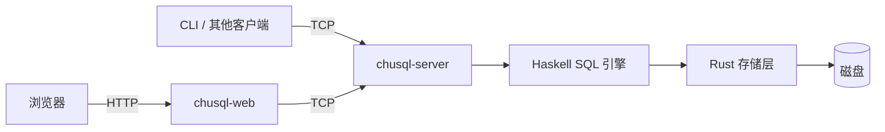

# 架构与组件

[← 返回 README](../README.md)

本页面向需要理解或修改 ChuSQL 的开发者，说明组件职责、查询执行过程和存储边界。SQL 用法见 [SQL 语法](syntax.md)。

ChuSQL 采用客户端 / 服务端架构。正常运行时只有数据库服务直接访问数据文件，离线初始化和恢复由 bootstrap 完成。

| 术语 | 含义 |
| --- | --- |
| schema（表结构） | 列名、类型和约束等定义；语义检查与优化以此为依据 |
| catalog（系统目录） | 记录数据库对象及其结构的元数据；表是否存在以此为准 |
| 绑定与槽位 | 绑定把列引用对应到输入行的位置，这个位置称为槽位 |
| 结构守卫 | 执行前和存储锁内复查依赖，拒绝使用已经失效的表结构 |
| DOMAIN（领域类型） | 为基础类型命名、可附加默认值和约束的自定义类型 |
| WAL / LSN | WAL 是恢复用的预写日志，LSN 是标识日志进度的递增序号 |
| DML / DDL | DML 包括插入、更新和删除数据；DDL 包括创建、修改和删除结构 |

本页内容：

- [组件与访问路径](#组件与访问路径)
- [数据目录](#数据目录)
- [会话与并发](#会话与并发)
- [SQL 查询处理](#sql-查询处理)
- [快照事务与行锁](#快照事务与行锁)
- [WAL 与崩溃恢复](#wal-与崩溃恢复)
- [页面与空间回收](#页面与空间回收)
- [身份、授权与系统目录](#身份授权与系统目录)
- [权限变更与会话失效](#权限变更与会话失效)
- [扩展方向](#扩展方向)

## 组件与访问路径

客户端通过服务端访问存储，浏览器先连接 Web 管理端：

| 组件 | 职责 |
| --- | --- |
| chusql-server | 登录、会话、鉴权、SQL 执行和事务 |
| chusql-web | Web 管理界面，通过 TCP 访问服务 |
| csql | 命令行客户端，通过 TCP 执行 SQL |
| chusql-core/engine | 解析、语义检查、优化及执行 |
| chusql-core/storage | catalog、页面、B+ 树、缓存、WAL 与持久化 |
| csql-bootstrap | 安装引导，以及离线的系统目录修复、恢复和重置 |

服务默认监听 127.0.0.1:7777，Web 默认监听 127.0.0.1:7778。配置位置和平台数据目录见[配置选项](config.md)。

### 存储名称校验

存储层解析库限定名后，物理表名、声明列名和写入行顶层字段名使用同一规则：名称非空，只含 ASCII 字母、数字和下划线。SQL 标识符另受解析器规则约束。

单行写入、批量写入、整表替换、结构替换和事务载荷在处理请求时拒绝非法字段名，不改数据也不写 WAL。校验不遍历文本内容或复合值内部的键。

旧数据不会自动改名，原始扫描和历史 WAL 重放保持兼容；后续重写时需提供合法字段名。

## 数据目录

`[storage] data_dir` 保存持久化数据，`log_files` 单独指定诊断日志目录。

| 位置 | 内容 |
| --- | --- |
| system/ | 身份、凭据、角色、授权和预定义类型目录 |
| databases/<数据库名>/ | 业务数据库的 catalog、数据与索引 |
| WAL 与检查点文件 | 已提交写入的恢复记录及刷盘进度 |

安装只初始化系统数据库，业务数据库由用户创建。表是否存在以 catalog 为准，数据文件保存物理内容。

## 会话与并发

- 每条 TCP 连接拥有独立会话，当前数据库和事务互不影响。
- 服务端数据请求共享全局权限门，同库不同记录可以并行准备修改；最终校验与提交独占目标库的短提交门，不同数据库可以并行提交。权限、DDL 和管理员存储请求独占全局门。库门按名称排序获取，取消时释放，避免跨库等待环。存储层另有每库读写门和表锁。
- Web 与 CLI 都通过服务端执行权限检查和数据访问。
- Web 登录会话分别持有普通 API / SQL 连接和表格编辑连接，编辑事务按页面标识固定数据库。表格读取带编辑标识时使用该事务快照，普通查询走独立连接。
- 同一 Web Cookie 的请求串行执行。编辑提交以固定保存点重放本地编辑集，失败整体回退，成功回执按提交标识去重。SQL 控制台事务按页面和标签标识限制连接访问。

## SQL 查询处理

查询依次经过解析、基于 schema 的语义检查、优化和执行。库名、表名、列名及别名在语义层解析，存储层使用精确的表名键。

### 解析后的查询表示

解析器把 SQL 转成抽象语法树（AST）。`Select` 的字段与辅助函数分工如下：

| 名称 | 用途 |
| --- | --- |
| `selectItems :: [(String, Expr)]` | 输出名称与投影表达式，即查询要返回的列或计算结果 |
| `selectHaving` | 分组条件 |
| `OrderKey` | 区分按名称、输出序号和表达式排序 |
| `Col` | 普通列；别名、计算和聚合使用相同的投影项结构 |
| `makeSelect` | 接受列名列表并构造投影项 |

### 类型能力与复合值运算

运行时类型描述保存相等比较（Eq）、排序（Ord）和哈希（Hash）能力，复合类型按参数递归派生。语义检查按运算要求能力，DOMAIN 沿用基础类型。值排序和哈希按结构执行，嵌套浮点正负零保持相等且哈希一致。

值与类型编码保持版本 1，能力由代码中的类型描述提供。索引键编码是独立约束，运行时复合键不进入索引探测。规则见 [复合值的比较、排序与分组](types.md#比较排序与分组)。

### 绑定查询与结构复查

绑定查询保存依赖对象编号、schema 版本、列定义以及直接和间接依赖的 DOMAIN。执行前复查，真实存储的每次读取还在相关库读锁内验证全部依赖；结构改变或对象替换会明确报错。结构守卫只检查对象定义，SQL 数据可见性由存储事务提供；旧目录的未知身份或版本保留兼容校验，旧存储未确认守卫时拒绝执行。

`Runtime.Query.bindQuery` 统一准备并绑定查询，输出按位置校验并保留重复列名。优化完成后把表达式、排序和分组键绑定到输入布局；物理列顺序不同时在存储边界整理，缺列或位置不符明确报错。

`ORDER BY` 输出序号保留到计划生成，选择对应的投影表达式或 DISTINCT 输出槽位，非排序投影仍在 LIMIT 后求值。

### 聚合与排序的求值顺序

聚合计划合并投影、HAVING 和排序表达式中的当前层聚合，重复调用只计算一次。内部列使用 SQL 标识符无法声明的名称。

HAVING 强制形成分组，没有分组键时把输入当作整体组。HAVING 过滤位于聚合算子之后、去重和排序截断之前。

表达式排序先计算隐藏排序键并保留投影所需列，再排序、截断和投影。DISTINCT 排序映射到已有输出槽位。HAVING 和排序子查询同样参与结构依赖守卫与 SELECT 权限检查。

### 相关子查询的列查找

相关子查询引用外层列，列查找因此区分内外层作用域。

按最近到最远的独立列作用域查找，最近层出现歧义时立即报错；二段限定引用只在最近声明该来源的层解析，裸列可以继续向外查找。

`BoundSubquery` 保存父布局中的取值表达式，缓存按槽位和值区分；重绑定保留局部和外层身份，原位置失效时只允许唯一同名列重定位。

执行期外层行仍是扁平结构，没有独立作用域或来源编号，结构改写须在绑定前完成。

### 写入求值与约束检查

写语句按目标 schema 绑定输入表达式和赋值目标：

- INSERT 拒绝重复目标列，按输入顺序求值，再按 schema 顺序补默认值、NULL 和自增值。
- UPDATE 的重复赋值读取前一次修改结果。全部赋值后检查 CHECK，再检查最终行集的 NOT NULL、UNIQUE 和 PRIMARY KEY。
- 唯一性检查保留整数与整值浮点的一致语义，允许多个 NULL；全部检查通过后才发布修改。
- CHECK、非空和唯一性按列槽位取值。INSERT 已有行及引擎 ALTER 输入行按原 schema 整理，缺列时明确报错。

### 可复用的写计划

INSERT、UPDATE、DELETE 和已有表的结构变更由 `Engine.bindWrite` 生成保存结构信息的 `BoundWrite`，`executeWriteM` 在执行前复查结构，因此可以跨数据及统计变化复用。

DML 在绑定阶段固定 INSERT 输入槽位、UPDATE 目标槽位、DELETE 行布局和 CHECK / NOT NULL / UNIQUE / PRIMARY KEY 约束；复用时直接使用已绑定内容，自增起点和行集约束取当前数据。结构变更在执行时对变更后的 schema 绑定并检查约束。

计划携带目标表、嵌套查询和传递 DOMAIN 依赖；ADD COLUMN / ALTER TYPE 还包含新声明类型的 DOMAIN。建表、建删库、DOMAIN 管理和会话命令使用各自的管理入口。

### DOMAIN 约束的变更

DOMAIN 的 CHECK 在独立 VALUE 槽位绑定，继承的默认值和非空限制按当前领域目录合成，表列保留原始声明。创建依赖 DOMAIN 的表或领域也通过结构守卫复查定义。

ALTER DOMAIN 按以下顺序校验和提交：

1. 在存储库读锁内取得完整快照，校验直接及间接依赖和已有行。
2. 以库身份和 WAL 检查点作为令牌，在写锁内再次比较。
3. 令牌一致时通过 `ReplaceSchema` 提交；期间任何普通提交都会使令牌失效并返回 `serialization_failure`。

约束变更复用现有目录版本、WAL 和恢复路径，通用结构事务属于后续规划。

### 存储操作的结构守卫

写入前先发送只读的 `validate_write` 请求，确认存储支持写守卫并校验依赖，成功后才发送修改请求。

实际读取在相关库共享门内复查，实际写入在目标库独占门及其他依赖库共享门内复查，跨库时按库名排序取门。

对象替换或结构版本变化会使旧绑定失效，结构改变后恢复原定义也一样。

守卫让结构校验与单次存储操作处在同一结构保护范围。SQL 写语句的数据快照、行锁和冲突检测由事务层提供，见[快照事务与行锁](#快照事务与行锁)。

### 修改表结构时的约束校验

CHECK 定义和执行共用类型、函数及列槽位绑定入口，拒绝聚合、子查询和非布尔条件。修改表结构时还要遵守：

- DROP COLUMN 校验保留下来的 CHECK。
- RENAME COLUMN 保留约束文本，执行前须处理引用旧名称的 CHECK。
- ALTER TYPE 依据新 schema 校验 CHECK、默认值和键能力，空表同样执行定义校验；通过后仍检查已有行，再发布结构变更。

### 查询优化的能力与边界

统计信息只影响计划选择，优化保持查询结果语义：

| 能力 | 实现与边界 |
| --- | --- |
| 派生表 | 内层独立解析，必须有别名，只引用内层可见列；输出列按别名暴露 |
| WITH / CTE | 解析时展开为派生表；相同执行子树在查询内物化复用，递归支持待实现 |
| ANY / ALL | 按 OR / AND 的三值逻辑求值；空集的 ANY 为假、ALL 为真 |
| 子查询复用 | 按查询定义及外层绑定值物化结果，跨过滤、投影、排序与 JOIN 复用 |
| 半连接 / 反连接 | 独立 IN / NOT IN 与简单等值相关 EXISTS / NOT EXISTS 转为哈希存在性匹配，只输出左行 |
| 成本估算 | 使用行数、不同值数和数值列的 16 桶等宽直方图 |
| 索引选择 | 优化器判断适用条件与成本，存储层管理实际索引 |

#### 连接重排与投影下推

派生表可按 schema 和透明算子估计行数，参与安全的连接重排；缺统计或可能报错时保守处理。投影下推保留所有计算项的求值和错误返回。内存存储提供实时行数和封顶去重统计。

#### 子查询结果的复用

执行器用查询内状态保存首次使用时成功求出的子查询行，键包含已解析的查询定义和具名外层绑定值，跨不同父布局复用；原始名称调用保守地包含整个外层行。

派生表按执行子树和外层行缓存，在应用来源别名前复用，优化后子树不同则分别执行。标量、IN、EXISTS 和 ANY / ALL 各自处理共享行集，保留基数错误和三值逻辑。

缓存生命周期限于单次执行，既有表达式分组求值顺序保持，JOIN 空行对仍不触发子查询。

子查询缓存不控制数据可见性，SQL 查询通过自动提交或显式事务读取一致快照。物化结果保存在内存中，预算控制和磁盘溢出待实现，大查询需预留足够内存。

#### 用存在性匹配加速子查询

半连接与反连接按右侧是否存在匹配行筛选左行，只输出左侧列。`SemiJoin` 分别绑定两侧键，只暴露左侧布局；左侧为空时不求右侧，其他情况完整求右侧并构建键集合，按原左行顺序过滤，右侧重复键不会放大结果。

独立 IN 保存原子查询身份，继续共享其他消费者的物化结果；NOT IN 跟踪右侧 NULL，NOT EXISTS 把空值键视作不匹配。大整数与浮点混合比较超出安全哈希范围时退回逐值比较。

重写只覆盖单独过滤谓词：IN 左键限普通列或简单字面量；相关 EXISTS 限单表、唯一外层等值引用和普通列／简单字面量投影。组合谓词、复杂相关条件、聚合、排序截断及可能报错的相关投影继续走原路径，保持错误时序和词法作用域。

完整 SQL 写法及限制见 [SQL 语法](syntax.md)。

## 快照事务与行锁

MVCC（多版本并发控制）给每条逻辑行分配不复用的内部编号和版本链，事务读取开始时可见的版本和自身修改。库内提交序号使用 WAL 提交 LSN；`mvcc.json` 保存版本快照，`mvcc.delta` 保存带校验和的增量记录。堆与索引同步后先同步版本记录，再推进库检查点。旧目录在首次写入或开始事务时导入版本，原页格式保留。

| 阶段 | 行为 |
| --- | --- |
| BEGIN | 注册存储事务和快照引用，返回开始时的结构，暂不传输表行 |
| 事务内执行 | 按需读取开始快照的表和列，修改行和唯一键在语句成功前取得锁 |
| SAVEPOINT | 保存工作行集和读依赖；回滚同步存储计划，已有锁保留到事务结束 |
| COMMIT | 在短提交门内合并最新版本，校验权限、对象、读写依赖及最终约束，再经 WAL 发布 |
| ROLLBACK / 断线 | 清除计划、快照引用、锁和等待边；保存点不能跨连接恢复 |

查询从优化后的扫描布局提取需要的列，复杂子查询和索引回退保留完整行。后续语句需要更多列或执行写入时，补读同一开始快照的完整行，并补齐保存点中的原始数据。提交预检只传输修改表及其类型依赖。

每个会话最多保留最近一条查询的绑定计划，缓存不保存行数据。表名、对象身份、结构版本或列定义变化时重新绑定；权限与身份逐次复核，同次 CONNECT 和表权限检查共用目录快照，事务对象编号通过一次 catalog 读取复查。

无子查询的过滤和投影直接求值；LIMIT 包裹过滤或投影时只保留所需输出，仍检查原计划应报告的错误。

普通提交只扫描受影响表，未改表共享不可变版本链。增量记录保存变化的行链和删除信息；增量文件超过快照大小且超过 1 MiB 后，下次发布将其归并为完整快照。归并先原子发布快照，再同步截断增量，重启时跳过快照已包含的记录。末尾不完整记录被丢弃，完整记录校验失败则拒绝打开。

版本目录可读旧格式 1，首次发布写入格式 2，旧程序会拒绝打开格式 2。备份必须包含整个数据目录，尤其是 `mvcc.json` 和 `mvcc.delta`；回退时使用旧程序和升级前的完整备份。

行锁覆盖内部行编号及旧、新唯一值，唯一值锁只覆盖非 NULL 值。同一库中不同行可以同时准备修改，等待行锁时释放库提交门。等待图检测环并中止形成环的等待者；总等待上限 5 秒，分别返回 `deadlock_detected` 或 `lock_timeout`。版本冲突返回 `serialization_failure`。调用方须 ROLLBACK，再从 BEGIN 重做完整事务。保存点回滚后仍持有此前取得的锁。

默认 BEGIN 提供快照隔离，复查写入行的内容版本。SERIALIZABLE 写事务另外按表复查所有读依赖，包括子查询和幻行，因此不同记录的变化也可能导致保守冲突；只读事务可以完成原快照读取。DDL 和切换数据库须在事务结束后执行。

自动提交的查询和数据写语句也使用存储事务。权限和 DDL 使用全局独占门，数据准备使用共享门，同库提交校验和 WAL 发布仍按顺序完成，以保留连续的已应用提交前缀。原始管理员存储写入不取得 SQL 事务行锁，但会发布版本，旧事务随后按版本冲突规则拒绝提交。

SQL 工作行集仍在 Haskell 中按表物化，没有按条件取版本或分批扫描。普通提交需要比较修改表的完整行集；账号提交、旧格式导入和 WAL 恢复保留整库同步。结束事务释放内存中的旧版本，后续增量记录回收边界，快照归并收缩磁盘版本。长期快照和大表会增加内存、磁盘和 I/O 成本。

### 在线空间整理

显式 `compact` 把快照中的存活行复制到独立代次的影子堆和索引，复制期间继续接受 SQL 数据写入。切换前短暂独占库门，保留最新行集的有序前缀，删除影子中的过期行并按最新顺序追加其余行；并发变化较多时，切换窗口可能重写较长后缀。

影子文件同步完成后，用 WAL 的 Migrate 操作发布 catalog 中的 `file_generation`，逻辑对象编号和结构版本不变。旧快照结束后删除退役文件；重启先恢复切换日志，再清理未发布和退役代次。启动时的隐藏列整理仍使用离线重写。备份须包含整个库目录及页侧文件。

## WAL 与崩溃恢复

预写日志记录已提交的修改，检查点记录已完成刷盘的位置。写入和恢复按以下顺序进行：

1. 一组写操作和提交标记写入 WAL，每条记录带递增 LSN。
2. 数据页和索引页覆盖前，完整页镜像与校验和先同步到对应 `.page-wal` 文件。
3. 数据文件同步后，原子替换 `.pages` 中的页 LSN 和写序号，再清理镜像日志。
4. 数据、页版本和 catalog 刷盘后，同步行版本增量或原子发布完整版本快照，再把库检查点推进到已完成提交的 LSN。
5. 按检查点截断日志前缀，保留尚未确认刷盘的记录。
6. 重启时先按有效全页镜像修复撕裂写，再重放库检查点之后的已提交组，丢弃未提交组，并做幂等检查。

页镜像有独立递增写序号，同一事务可以多次刷新同一页，不能仅凭相同页 LSN 跳过后一次写入。未完整写出的尾帧丢弃，完整帧校验失败则明确报错并保留材料。镜像写入或检查点失败后，当前页句柄拒绝继续刷新，析构也不能绕过恢复。

已提交组恢复前丢弃受影响表的派生索引，再从堆数据重建，避免残缺索引根阻断逻辑重放。整表日志直接重写，不依赖可能不完整的行集判断是否已应用。

建表、删表、建索引、删索引、账号和数据修改都进入带提交点的 WAL。LSN 跨重启续号，SystemStatus 的 `last_lsn` 表示检查点 LSN。

系统目录损坏导致服务无法启动时，使用离线 bootstrap；repair、recover 与 reset 的范围和步骤见[系统引导与恢复](bootstrap.md)。

## 页面与空间回收

- 删除行先把槽位标记为墓碑。
- 死空间达到页大小的四分之一时，随删除整理页内活行。
- 整理保留槽位编号，索引中的页号和槽号继续有效。
- 显式 compact 在线复制存活行、补齐并发修改并经 WAL 切换文件代次，回收跨页空洞和隐藏列字节，同时重建索引位置。

跨页整理的复制阶段允许并发数据写入，最终追平和切换仍独占库门。旧快照引用会阻止退役文件回收。整理保留切换时的逻辑行序，查询结果需要确定顺序时使用 ORDER BY。

## 身份、授权与系统目录

系统表统一使用 `__system_` 前缀，身份与凭据目录对普通语句隐藏。SUPERUSER 拥有最高权限，`system_catalog_manager` 提供受限的目录管理能力，两者由身份自身属性决定。

| 机制 | 行为 |
| --- | --- |
| 角色继承 | 沿成员关系取得权限并集；拒绝自继承与环 |
| 对象授权 | 数据库 CONNECT / CREATE，表 SELECT / INSERT / UPDATE / DELETE；ALL 按作用域展开 |
| 转授权 | WITH GRANT OPTION 允许把持有的权限授予其他身份 |
| 撤销 | 授予者撤销自身来源；所有者或最高权限身份管理对象授权，级联清理无合法来源的下游 |
| 稳定对象 | catalog 分配数据库和表编号，授权与所有者绑定对象和身份编号，删除后不复用 |
| 所有者 | 建表者获得表所有权；启用角色可继承所有权，他人表的数据权限需另行授予 |

对象权限目录 `__system_object_acl` 对普通语句和存储请求隐藏。

权限快照按字符分块，在系统库写锁内比较版本，并通过同一 WAL 组替换；服务启动时恢复建表前持久化的创建者声明，旧名称授权只迁移一次到现存稳定对象。

类型目录见[类型与类型目录](types.md)，身份字段与权限边界见[用户与角色](users-and-roles.md)。

## 权限变更与会话失效

账号、属性和授权变化会标记受影响的在线连接。角色变化先展开成员及转授权来源关系，确定涉及的登录身份。共享读写门允许查询并行，并把数据写入、提交、授权及对象结构变更与查询排序；事务提交再次验证权限和稳定对象编号。

TCP 连接在下一次请求时返回 `unauthorized` 并关闭，空闲连接保留到下一次请求；权限逐条查询，避免继续使用旧授权。Web 会话还通过账号版本校验，口令或身份变更使旧凭据失效。

## 扩展方向

> [!NOTE]
> 以下为后续规划，实际可用能力以进度文件为准，见 `.agents/context/progress.txt`。

### 查询内部表示的后续完善

已有列槽位、类型化函数与 `BoundQuery`；后续补齐多级词法作用域、来源和列身份，以及写语句与约束的统一绑定。迁移保留同名遮蔽、NULL / DOMAIN、输出布局和错误时序，结构改写应在绑定前完成或重新绑定。

### 查询扩展

| 方向 | 前置条件与边界 |
| --- | --- |
| 物化资源控制 | 在查询内物化基础上增加内存预算、磁盘溢出及取消，保持事务快照与错误传播规则 |
| 递归 CTE | 先实现类型一致的迭代关系，明确去重、循环终止、轮次与行数预算；不隐含支持写入型 CTE |

### 存储扩展

行版本、行锁、同库数据准备与在线整理的边界见上文。后续优化按测量结果减少单表物化、版本归并和最终切换窗口；WAL 发布顺序、版本可见性与恢复约束保持一致。
