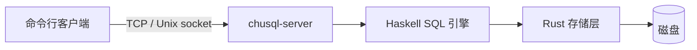

# 架构与组件

[← 返回 README](../README.md)

ChuSQL 由 Haskell SQL 引擎和 Rust 存储层组成。客户端通过服务端访问数据，离线维护由 `csql-bootstrap` 完成。

## 组件与访问路径

| 组件 | 职责 |
| --- | --- |
| `chusql-server` | 登录、权限、会话和事务 |
| `csql` | 命令行客户端 |
| `chusql-core/engine` | SQL 解析、检查、优化和执行 |
| `chusql-core/storage` | 数据页、索引、系统目录和持久化 |
| `csql-bootstrap` | 初始化与离线系统目录修复 |
| `chusql-haskell-driver` | 独立仓库中的 TCP 连接、会话和协议编解码 |

Haskell 客户端从远程 [Haskell 驱动仓库](https://repo.chunana.cn/ChuNa7a/ChuSQL-HaskellDriver)获取 `main` 分支源码归档。驱动自行定义协议数据结构，查询值保留为 JSON，不依赖主项目的内核模型、查询引擎或存储动态库。配置、TOML、口令哈希与认证会话位于服务端源码目录，CLI 和引导程序引用对应的公开模块。

服务端在 `ChuSQL.Server.Protocol` 中编码内核结果，两端通过版本化 TCP 协议保持兼容；接入方法见[驱动参考文档](https://repo.chunana.cn/ChuNa7a/ChuSQL-HaskellDriver#参考文档)。

Linux 上本机 root 可经 Unix socket 免口令登录，服务端按对端 uid 认证。

## SQL 查询处理

SQL 依次经过解析、语义检查、优化和执行。语义检查与优化依据表结构，执行前复查所依赖的对象和类型；结构变化会使旧计划失效。

优化包括索引选择、过滤与投影下推、连接重排和子查询结果复用。优化须保持查询结果及错误行为，实际索引由存储层管理。

SQL 写法见[语法参考](syntax.md)，类型规则见[类型说明](types.md)。

## 会话与并发

每条连接拥有独立会话和当前数据库。客户端在连接中执行 SQL，并显式提交或回滚事务。

不同记录可并行准备修改，同一数据库的最终校验与提交按顺序执行。权限和结构变更与数据操作协调，事务提交时再次检查权限。

## 快照事务与行锁

多版本并发控制（MVCC）让事务读取开始时的快照和自身修改。默认事务提供快照隔离，SERIALIZABLE 额外检查读取依赖；后者按表检查，可能产生保守冲突。

写入使用行锁和唯一值锁。遇到冲突、死锁或锁等待超时，调用方执行 ROLLBACK 后重做完整事务；保存点回滚保留已取得的锁。

## 数据目录

系统库保存身份、授权和类型；业务库保存表、索引、日志及版本信息。对象存在性以系统目录（catalog）为准。

数据目录由单个服务进程使用。备份须在停机后复制完整目录，版本回退使用升级前备份。路径配置见[配置选项](config.md)。

## WAL 与崩溃恢复

预写日志（WAL）先记录提交，再更新数据、索引和版本信息，最后推进检查点。重启时恢复已提交记录，并通过页镜像处理撕裂写。

持久化失败后服务进入恢复状态，保留日志供重启处理。系统目录的离线维护见[引导与恢复](bootstrap.md)。

## 页面与空间回收

删除会留下可回收空间。页内整理保留原定位；显式 `compact` 在线复制存活行并切换文件，最终切换短暂独占库门。旧快照结束后回收退役文件。

## 身份、授权与系统目录

用户和角色共享身份目录。角色可继承业务权限，最高权限由登录身份自身属性决定。授权绑定稳定对象编号，删除后重建同名对象不会恢复旧授权。

权限变化使相关连接在下一次请求时失效。管理方式见[用户与角色](users-and-roles.md)。

## 扩展方向

后续重点是递归查询、物化资源控制，以及减少大表读取和最终提交的成本。完成状态与限制分别见 `.agents/context/progress.txt` 和 `.agents/context/known-issues.txt`。
